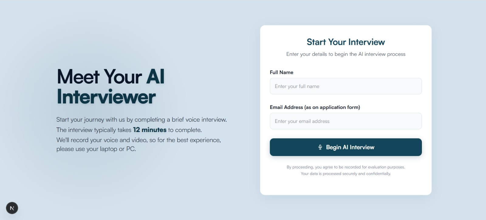
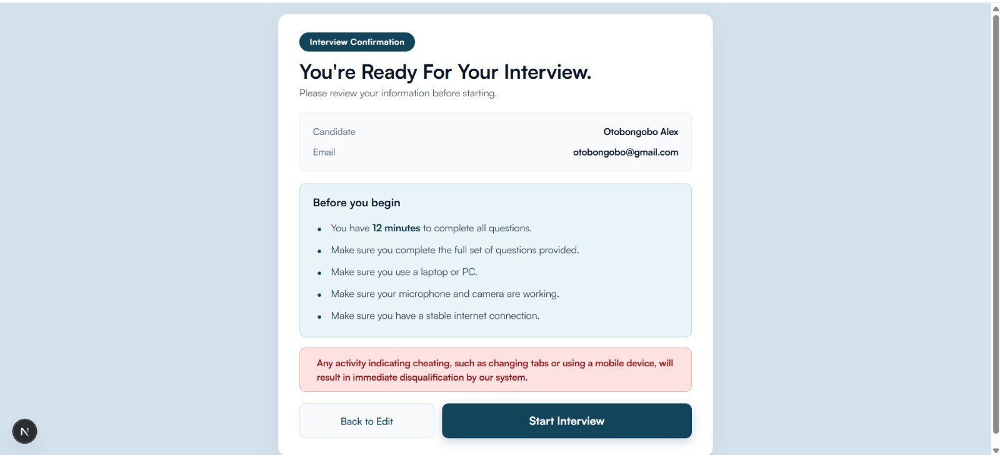
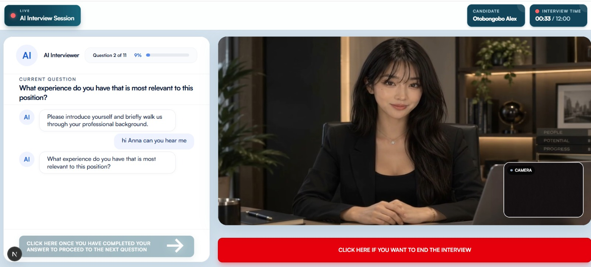
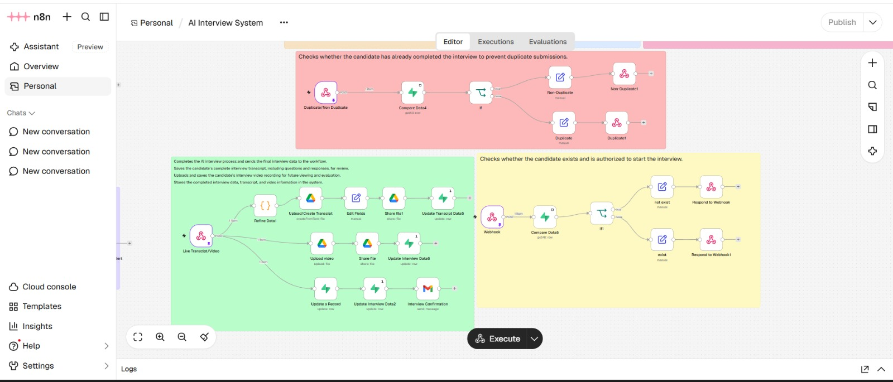

# 🎥 AI-Powered Interview & Assessment System


---

## 📺 System Walkthrough

🎥 Watch the complete technical demonstration and AI interview automation workflow:

https://www.loom.com/share/9053443df8b34148b4b3105c0631358c

---

## 🔗 Connected Recruitment System

This project is integrated with the **AI-Powered ATS Recruiter Dashboard**, connecting initial resume screening with AI-powered candidate interviews and assessments.

👉 [**View AI-Powered ATS Recruiter Dashboard Repository**](https://github.com/muneebservices09/AI-Powered-ATS-Recruiter-Dashboard)

The ATS Dashboard handles initial resume analysis, candidate scoring, and recruiter evaluation. Once a recruiter selects a suitable candidate, an interview invitation is sent through the dashboard.

The completed interview assessment, original recording, and conversation transcript are then made available for recruiter review.

---

## 🚀 Project Overview

The **AI-Powered Interview & Assessment System** automates candidate interviews through an interactive AI interviewer that conducts voice and video interviews, records candidate responses, and captures the conversation transcript.

Integrated with the ATS Recruiter Dashboard, the system allows recruiters to invite candidates based on their initial ATS assessment. After the interview, the candidate's recording, transcript, and AI-generated interview assessment are processed and connected back to the recruiter's dashboard.

This creates a connected recruitment workflow from **resume screening and candidate selection to AI-powered interviewing and interview assessment**.

---

## 🔄 Complete Recruitment Workflow

The system connects the candidate application process, ATS evaluation, interview invitation, AI interview, and recruiter assessment.

```text
Candidate Applies on Company Website
              ↓
Resume Submitted to ATS
              ↓
n8n AI Resume Analysis
              ↓
ATS Score & Candidate Assessment
              ↓
Candidate Details in Recruiter Dashboard
              ↓
Recruiter Reviews Candidate
              ↓
Recruiter Sends Interview Invitation
              ↓
Candidate Verification
              ↓
Interview Confirmation
              ↓
AI-Powered Voice & Video Interview
              ↓
Interview Recording & Transcription
              ↓
AI Interview Assessment
              ↓
Recruiter Reviews Complete Assessment in Dashboard
```

---

# 📝 The System Workflow

### 1️⃣ ATS Dashboard Integration & Candidate Selection

The process begins inside the existing **AI-Powered ATS Recruiter Dashboard**.

When candidates apply through the company's website, their resumes are processed through an n8n AI workflow. The system extracts candidate information and generates an initial assessment.

Recruiters can review:

- Overall ATS Score
- Relevant Experience
- Technical Skills
- Salary Expectation
- Availability
- AI-Generated Summary
- Candidate Strengths
- Candidate Gaps
- Recruitment Recommendation

Based on this assessment, recruiters can identify suitable candidates and send interview invitations directly through the dashboard.

👉 **[Explore the ATS Recruiter Dashboard Repository](https://github.com/muneebservices09/AI-Powered-ATS-Recruiter-Dashboard)**

---

### 2️⃣ Candidate Interview Invitation & Registration

Once the recruiter sends an interview invitation, the candidate receives an interview link.

The candidate opens the link and enters the required information.

The system uses the candidate's information to associate the interview with the corresponding application.

<div align="center">
  
</div>

---

### 3️⃣ Interview Confirmation & Instructions

Before starting the interview, candidates are presented with a confirmation screen containing their information and interview instructions.

The confirmation page explains the requirements for completing the interview successfully.

<div align="center">
  
</div>

---

### 4️⃣ AI-Powered Voice & Video Interview

After confirmation, the candidate enters the live interview interface.

The system features an interactive AI interviewer that conducts the interview through a conversational voice-based experience.

**Interview interface features:**

- AI Interviewer Avatar
- Current Interview Question
- AI Interviewer Questions
- Interview Progress Indicator
- Candidate Camera Preview
- End Interview Control

The AI interviewer asks questions, receives candidate responses, and continues through the interview conversation.

<div align="center">
  
</div>

---

### 5️⃣ Interview Recording & Conversation Transcription

During the interview, the system captures the candidate's responses and interview session information.

The recording and transcription workflow manages:

- Original candidate video recording
- Interview conversation transcript

The transcript provides a written record of the discussion between the AI interviewer and the candidate.

The original interview recording is also retained so recruiters can review the actual interview session.

---

### 6️⃣ Automated Interview Processing Through n8n

The backend interview automation is managed through **n8n workflows**.

The workflow coordinates candidate verification, duplicate checks, interview completion, recording storage, transcript processing, and candidate record updates.

**Candidate Verification**
- Verifies candidate eligibility to begin the interview.
- Returns the verification result to the interview application.

**Duplicate Interview Prevention**
- Checks whether the candidate has already completed an interview.
- Routes duplicate and non-duplicate records through separate workflow paths.

**Interview Completion & Data Processing**
- Receives completed interview information.
- Processes interview transcripts.
- Uploads and stores interview recordings.
- Sends interview confirmation emails.

<div align="center">
  
</div>

---

### 7️⃣ Interview Recording & Transcript Storage

The completed interview information is processed and stored through the connected backend workflow.

**Google Drive** is used for storing and managing interview-related files.

---

### 8️⃣ AI-Powered Interview Assessment

After the interview is completed, the candidate's interview information is processed for assessment.

The AI-powered assessment provides recruiters with structured insights based on the candidate's interview responses.


**Candidate Evaluation:**

- Relevant Experience
- Technical Skills
- Candidate Strengths
- Candidate Gaps
- Interview Responses
- AI Interview Assessment

This helps recruiters make more informed decisions using both resume information and interview results.

---

### 9️⃣ Centralized Recruiter Dashboard & Interview Review

The completed interview information is connected back to the **ATS Recruiter Dashboard**.

Recruiters can review the candidate's initial resume assessment alongside the completed interview information.

The dashboard provides access to:

- Candidate Information
- Initial ATS Score
- AI-Generated Resume Summary
- Candidate Strengths and Gaps
- Interview Assessment
- Original Interview Recording
- Full Interview Transcript

---

## 🛠️ Technical Stack

| Layer | Technology |
| :--- | :--- |
| **🌐 Interview Application** | **Next.js** |
| **💻 Programming Language** | **TypeScript / JavaScript** |
| **⚙️ Workflow Automation** | **n8n** |
| **🎙️ Voice Interaction** | **Web Speech APIs** |
| **📹 Media Recording** | **MediaRecorder API** |
| **🎥 AI Interviewer Avatar** | **Yuna Interactive Video** |
| **📁 File Storage** | **Google Drive** |
| **📨 Email Notifications** | **Gmail Integration** |
| **🔗 Backend Integration** | **Webhooks & REST APIs** |
| **📊 Recruitment Integration** | **AI-Powered ATS Recruiter Dashboard** |

---

## 🚀 Business Impact

The system transforms a traditionally manual interview process into an automated AI-powered interview and assessment workflow.

### Before Automation

**Recruiter Reviews Candidate → Manually Coordinates Interview → Conducts Interview → Takes Notes → Saves Recording → Reviews Candidate Responses → Prepares Interview Assessment → Updates Recruitment Records**

### After Automation

**ATS-Based Candidate Selection → Automated Interview Invitation → AI-Powered Interview → Automatic Recording & Transcription → AI Interview Assessment → Centralized ATS Dashboard → Recruiter Review**

---

## 🔗 Connected Recruitment Ecosystem

This project is part of a broader AI-powered recruitment infrastructure.

| System | Purpose | Repository |
| :--- | :--- | :--- |
| **AI-Powered ATS Recruiter Dashboard** | Candidate applications, resume analysis, ATS scoring, recruiter insights, and interview invitations. | [View ATS Repository](https://github.com/muneebservices09/AI-Powered-ATS-Recruiter-Dashboard) |
| **AI Interview & Assessment System** | AI-powered interviews, voice/video recording, transcription, and interview assessment. | Current Repository |

Both systems work together to connect initial candidate screening with the interview and assessment process.

---

## 🚀 Key Result

The system connects the complete recruitment journey:

**Candidate Application → AI Resume Screening → ATS Scoring → Recruiter Selection → Interview Invitation → AI Voice & Video Interview → Recording & Transcription → AI Interview Assessment → Centralized Recruiter Dashboard → Hiring Decision**

This creates a connected **AI-Powered Interview & Candidate Assessment System**, helping recruitment teams reduce manual interview work while maintaining access to structured candidate assessments, original interview recordings, and complete conversation transcripts.

---

## ✍️ Author

**Muneeb Ali Khan**

**AI Automation & GTM Engineer**

- **LinkedIn:** [Muneeb Ali Khan](https://www.linkedin.com/in/muneeb-ali-khan-2a1675365)
